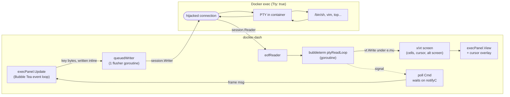
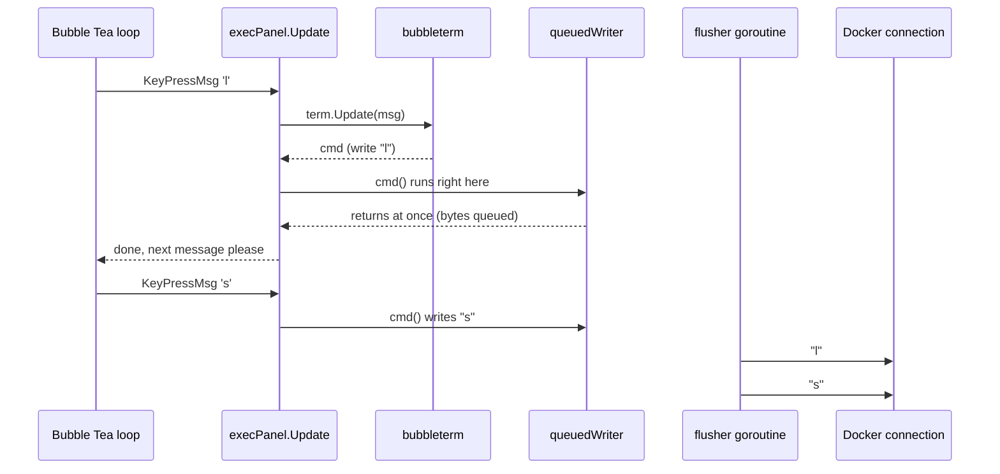

# How the exec panel works

The Exec panel opens `/bin/sh` inside a running container and shows it as a
real terminal. You can run `vim`, `top`, use tab completion, hit Ctrl+C, and so
on. This doc explains how the bytes move around and why some of the code looks
the way it does.

Main files:

- `internal/ui/sections/containers/exec_panel.go`: the panel
- `internal/ui/sections/containers/exec_writer.go`: `queuedWriter`
- `internal/client/docker_container_service.go`: `Exec` and `ExecResize`
- `internal/ui/sections/base/base.go`: input capture and `ctrl+]`

The terminal emulator is [`taigrr/bubbleterm`](https://github.com/taigrr/bubbleterm),
which wraps [`charmbracelet/x/vt`](https://github.com/charmbracelet/x/tree/main/vt)
for the actual escape sequence parsing.

## The big picture



There are two independent paths. Keys go left to right through the top, output
comes back through the bottom. The panel never draws what you type. It only
draws what the shell echoes back, same as a normal terminal.

## Where the bytes come from

`ContainerService.Exec` creates the exec with `Tty: true`. That makes Docker
allocate a pseudo-terminal (PTY) inside the container, so the shell believes a
real terminal is attached. It prints colours, moves the cursor around, switches
to the alternate screen for `vim`, and so on.

Docker hands us one connection with two directions, wrapped as
`client.ExecSession`:

- `session.Reader`: raw output from the PTY, escape sequences included
- `session.Writer`: bytes we send become keyboard input inside the container

There is no local process. That is why the panel uses
`bubbleterm.NewWithPipes(reader, writer)` and not `bubbleterm.New` or
`NewWithCommand`, which start a local process on a local PTY.

## Output: from the container to the screen

1. bubbleterm's `ptyReadLoop` goroutine reads a chunk from `eofReader`, which
   reads from `session.Reader`.
2. It takes the emulator lock `e.mu` and calls `vt.Write`. `x/vt` parses the
   escape sequences and updates its grid of cells, the cursor and which screen
   (main or alternate) is active.
3. It marks the screen as changed and signals `notifyC`.
4. A `tea.Cmd` started by `term.Init()` is waiting on that channel. It grabs the
   new frame and returns it as a message.
5. `bubbleterm.Model.Update` stores the rows and starts waiting again.
6. `execPanel.View` returns the rows and draws the cursor on top
   (`renderCursor`), because bubbleterm's frame doesn't include it.

Some programs ask the terminal questions, like "where is the cursor?". `x/vt`
writes the answers to an internal pipe, and bubbleterm's `responseLoop`
goroutine forwards them to the shell through the same writer.

## Input: from a key press to the shell



bubbleterm turns the key into the bytes a real terminal would send (Enter is
`\r`, Ctrl+C is `0x03`, Up is `\x1b[A`). The container's PTY decides what to
do with them. For example, it turns `0x03` into `SIGINT`, or passes it through
if the program switched the PTY to raw mode, which `vim` does.

### Why the write happens inside `Update`

`term.Update(msg)` doesn't write anything. It returns a `tea.Cmd` that does the
write. If we returned that cmd to Bubble Tea, it would run in its own
goroutine, one goroutine per key, with no ordering between them. Type fast
enough (or let the tests type with no delay) and the shell gets `ceehho`
instead of `echo`.

Bubble Tea calls `Update` with one message at a time. So `sendKey` runs the
cmd right there, before returning. Key 1 is written before `Update` even sees
key 2.

`tea.Sequence` does not fix this. It only orders the cmds you pass to that one
call, and each key press is a separate call. With a single cmd it just returns
that cmd unchanged.

The old panel didn't have this problem because it collected a whole line in a
text input and wrote it once on Enter.

### Why `queuedWriter` exists

Writing inside `Update` means the write must not block, or the whole UI
freezes. There is also a deadlock inside bubbleterm:

1. `Emulator.Write` holds a read lock on `e.mu` while it writes to the shell.
2. `ptyReadLoop` reads the echo, then needs the write lock on `e.mu` to update
   the screen.
3. If the write can't finish until someone reads the echo, nothing moves.

With the mock (an unbuffered `io.Pipe`) this happens on the first key. With
real Docker the socket buffers hide it, until a large paste fills them.

`queuedWriter.Write` copies the bytes onto a queue and returns. One flusher
goroutine sends the queue to `session.Writer` in order. It has to be exactly
one goroutine, otherwise the order is lost again. Keystrokes are not merged
into bigger writes. They are tiny, so it isn't worth it.

Note that `queuedWriter` keeps the order it receives. It doesn't create it.
The order comes from writing inside `Update`.

## Resize

A resize has two parts and both are needed:

- `SetSize` resizes the emulator grid, so we draw the right number of rows and
  columns.
- `ExecResize` tells Docker the new size. Docker resizes the PTY and the shell
  gets `SIGWINCH`, so `vim` or `top` redraw at the new size.

If only one side changes, the program and the screen disagree about the size
and the output gets mangled.

## When the shell exits

In pipe mode, bubbleterm's read loop stops quietly on `io.EOF` and tells no
one. `eofReader` wraps the reader and closes a channel on the first read error.
A cmd waiting on that channel returns `execCloseMsg`, and the containers
section closes the panel.

`execCloseMsg` carries the session pointer. Closing session A produces an EOF
too, and that message can show up after you already opened session B. The
section ignores it if the session doesn't match the current one.

## Keyboard capture and `ctrl+]`

A shell needs Ctrl+C, `Tab`, arrows, Esc and plain letters, but docker-dash
uses those keys too (Ctrl+C quits, `Tab` switches focus, and so on). Panels
that need every key implement
`sections.InputCapturer`:

```go
type InputCapturer interface {
	CapturesInput() bool
}
```

The exec panel returns `true` while a session is live. When the focused panel
is capturing, `app.go` sends key presses and pastes straight to the section,
skipping the global bindings, and `base.Section` sends them straight to the
panel.

The only key that isn't passed through is `keys.Keys.ReleaseInput`
(`ctrl+]`, the old telnet escape key, which shells almost never use). It closes
the exec session, switches back to the Details panel and puts focus on the
list.

Panel switches use `tea.Sequence(previous.Close(), next.Init())` and not
`tea.Batch`. `Close` sends "clear help" and `Init` sends "add help". With
`tea.Batch` they race, and the `ctrl+] exit terminal` hint sometimes got wiped
right after it appeared.

## Known gaps

- **No scrollback.** bubbleterm only gives us the visible screen.
- **Mouse events are dropped.** bubbleterm uses whole-screen coordinates and
  doesn't know where the panel sits in the layout.
- **No bracketed paste.** Pasted text goes to the shell as plain text. `x/vt`
  can wrap pastes when a program asks for it, but bubbleterm doesn't expose
  that. In `vim` a multi-line paste may get auto-indented.
- **Arrow keys always use `\x1b[A` style.** A program can ask for `\x1bOA`
  instead (application cursor mode). bubbleterm ignores that. vim, readline and
  top accept both, so it hasn't been an issue.

## Tests

`exec_panel_test.go` starts a real `/bin/sh` behind a PTY (`creack/pty`),
which is the same thing Docker gives us with `Tty: true`. A small `driver`
runs each returned cmd in its own goroutine, like Bubble Tea does, so ordering
bugs show up in tests too. The tests cover echo, cursor positioning and
colour, Ctrl+C, resize, the alternate screen, `exit`, and the cursor overlay.

The mock client (`internal/client/mock.go`) has a small fake TTY shell: a `$ `
prompt, echo, backspace, Ctrl+C and `exit`. It is unbuffered on purpose,
which is how the `queuedWriter` deadlock was found.
